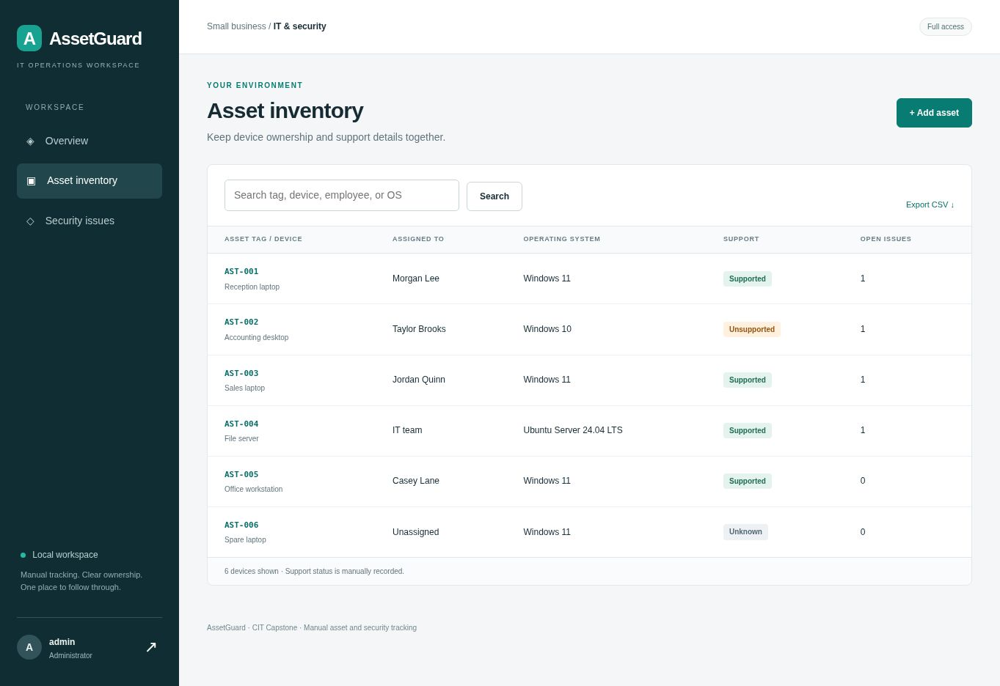
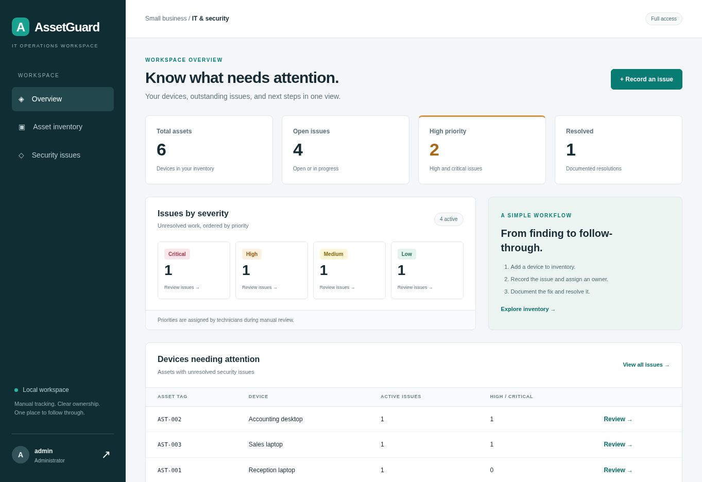
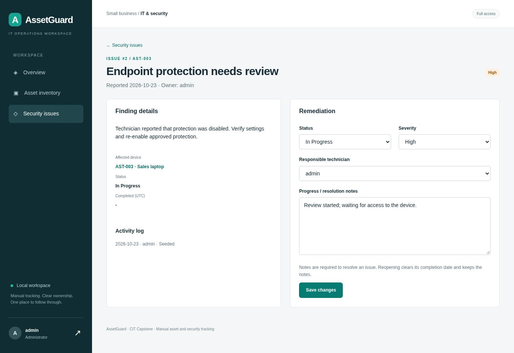

# Small Business IT Asset and Security Tracking System
## CIT Capstone - Final Project Report

AssetGuard | Local web application

Student: John Paul Perdicaro
Team name: Individual project
Course: IT Capstone
Instructor: Nan Wang
Semester: Fall Session 2 2026
Report date: October 24, 2026

### Team Members & Roles
| Name | Role |
| --- | --- |
| John Paul Perdicaro | Project owner; responsible for planning, development review, testing, documentation, and presentation. |

### Project summary
AssetGuard brings a small business's device inventory and manual security findings into one local web application. A technician can add a device, record a finding, assign responsibility, and document the resolution. A manager can review the same information through a read-only account.

The submitted system includes the source code, a portable Git repository, a fictional demo dataset, setup instructions, requirements and design documentation, and executed automated tests. All five proposed MVP features are implemented. The application runs locally; it has not been published as a live hosted service.

The system is packaged for local testing with a portable Git repository, automated tests, and supporting documentation. GitHub publication and the recorded presentation are not yet complete.

Use of AI tools: I used ChatGPT as a supporting tool to build on the project idea and help with coding, troubleshooting, testing, and preparing the documentation and report. I remain responsible for reviewing the work, verifying the results, and explaining the final system.

\pagebreak
# 1. Project Overview
## 1.1 Problem Statement
Small businesses may track device information in spreadsheets while keeping security follow-up work in email or separate notes. That arrangement makes it easy to lose track of who uses a device, who is responsible for an issue, and whether the problem was actually resolved. Even a simple finding can stay open if there is no clear record of ownership or next steps.

The target users are IT support staff and managers who oversee a small business's technology. Technicians need to maintain device details and track remediation. Managers need a readable summary without the ability to accidentally change records. Development and testing use fictional business data. External stakeholder acceptance has not been evaluated.

## 1.2 Project Objectives
- Keep device tags, names, assigned employees, operating systems, and support status in one searchable inventory.
- Link manual security findings to devices and assign each finding to a responsible technician.
- Track Open, In Progress, and Resolved work, including resolution notes and a completion date.
- Show accurate dashboard counts and a list of devices with unresolved issues.
- Enforce administrator and viewer permissions on the server and provide repeatable setup and test instructions.

## 1.3 Final Outcome
The delivered system is a local Flask web application with a SQLite database and server-rendered HTML. The browser interface uses the AssetGuard name. The seed creates six fictional devices and five issues: four unresolved and one resolved. One administrator and one viewer account support the demonstration.

The core workflow has been exercised through Flask requests against actual temporary SQLite databases. All 50 automated test cases passed: 42 application cases and eight local-tool cases. The captured desktop views were inspected separately. Live browser acceptance testing on Windows has not yet been completed.

The system is runnable from the source folder using Python 3.12. It binds to 127.0.0.1:5000 with debugging disabled. No cloud service, external account, API key, or network scan is required for the local demonstration.

\pagebreak
# 2. System Description
## 2.1 Key Features Implemented
| Planned feature | Delivered behavior | Status |
| --- | --- | --- |
| Asset inventory | Add, edit, search, and view devices; tags are unique without regard to case. | Complete |
| Security issue tracking | Findings reference an existing device and responsible administrator; severity and reporting time are stored. | Complete |
| Remediation workflow | Update status, owner, severity, and notes; resolving requires notes and records a completion time. | Complete |
| Dashboard | Shows asset totals, unresolved counts, high/critical work, resolved totals, and affected devices. | Complete |
| Account access | Administrators can write; viewers can read and export. Direct viewer write requests are rejected. | Complete |

Two small additions support the main workflow: inventory CSV export and recent activity metadata. The activity log records the actor, action, entity, and timestamp; it is not a complete before-and-after history.

## 2.2 Technologies Used
| Category | Technology |
| --- | --- |
| Frontend | HTML, Jinja templates, local responsive CSS; no JavaScript required. |
| Backend | Python 3.12; Flask 3.1.2; Werkzeug 3.1.3. |
| Database | SQLite through Python's sqlite3 module. |
| Cloud / Hosting | Local execution only; no hosted deployment. |
| Tools / Libraries | Git, pytest 8.4.2, Beautiful Soup for HTML assertions, ReportLab for this report. |

The proposal listed Bootstrap. The final build uses a local custom stylesheet instead so the demonstration has no CDN dependency. Flask, SQLite, Python, Git, and pytest remain consistent with the proposed approach. Automated scanning, device agents, email alerts, multi-company support, and AI risk scoring remain outside the MVP.

\pagebreak
## 2.3 System Architecture
[ARCHITECTURE]

The browser sends a request to Flask. Before a protected route is used, the application reloads the signed-in user's role from SQLite. Every POST also needs a valid CSRF token. Administrator checks run before changes are accepted, so hiding an edit button is not the only access control.

For a write, the route validates required text, maximum lengths, controlled selections, and linked records. SQL values are passed as parameters rather than inserted into SQL strings. A transaction saves both the updated record and its activity event. If the operation fails, the transaction is rolled back.

Flask then renders the result through a Jinja template. User-entered text is escaped. Successful writes redirect to a read page, which reduces accidental repeat submissions when the page is refreshed. CSS is served from the same application; no external application integration is used.

### Security boundaries
- The browser is untrusted. Required fields and dropdown choices are checked again on the server.
- Administrator and viewer roles are stored in SQLite; the browser does not choose its own role.
- Passwords are hashed. The local database and generated session secret are excluded from Git and the distribution.
- The default server listens on loopback. A public deployment would require a separate hosting and security review.

\pagebreak
## 2.4 Database Design
[DATABASE]

| Entity | Purpose and important fields |
| --- | --- |
| users | Unique username, password hash, role. One user can own many issues and activity records. |
| assets | Unique tag, device name, employee, operating system, support status, created time. |
| issues | Device and owner references, finding text, severity, status, reported/completed times, current notes. |
| activity | Actor, action, entity type, entity ID, timestamp. Logical entity reference, not a polymorphic foreign key. |

Foreign keys are enabled on each connection. An issue must reference an existing asset and user. The application additionally requires an administrator as the responsible technician. Asset tags and usernames have case-insensitive uniqueness rules.

A database CHECK constraint keeps resolution state consistent. Resolved issues require a completion timestamp and nonblank notes. Unresolved issues must not have a completion timestamp. Reopening clears the date, while editing an already resolved issue preserves its original completion time. Indexes support issue lookups by status and device.

The system does not delete devices or issues through the UI. This keeps the MVP small and avoids accidentally removing linked work. Activity records retain metadata only; detailed before-and-after changes would require a later design change.

\pagebreak
## 2.5 User Interface: Inventory and Overview


The inventory view combines search, ownership, operating system, support status, and unresolved issue counts. Asset tags open device details. Administrators see Add asset and Edit asset controls. Viewers use the same read pages without write controls. The operating system and support fields are manually entered, not automatically discovered or assessed.

\pagebreak
## 2.5 User Interface: Overview (continued)


The dashboard separates all unresolved work from high/critical work and completed issues. Severity is shown with words as well as colors. Devices needing attention excludes records whose only issues are resolved. Captures above are real Flask-generated HTML rendered through a static review server with fictional data; they are not evidence of live browser submissions.

\pagebreak
## 2.6 User Interface: Remediation Workflow


The finding panel shows the description, affected asset, current state, completion date, and activity metadata. The remediation panel lets an administrator select the owner, severity, and status and write progress or resolution notes. A viewer receives readable notes rather than this form.

### End-to-end acceptance scenario
1. Add a new device using a unique asset tag and required inventory details.
2. Record a High issue for the new device and assign the administrator as owner.
3. Move the issue to In Progress and record a progress note.
4. Try to resolve it without notes; confirm that validation rejects the change.
5. Add resolution notes and resolve it. Confirm the date is filled and the dashboard's unresolved count drops.
6. Reopen it and confirm the completion date is cleared.
7. Sign in as viewer and confirm that read pages work while writes remain forbidden.

The automated end-to-end test checks the workflow through Flask's test client. A separate local acceptance worksheet records browser-based results. Unsaved form text is not retained when the user navigates away.

\pagebreak
# 3. Development Process
## 3.1 Project Timeline
Development progressed through planning, design, implementation, testing, and local packaging. The initial build evidence is dated October 23, 2026; report revisions and local testing tools were added on October 24, 2026. The following table summarizes the completed phases.

| Phase | Work represented in the deliverable |
| --- | --- |
| Planning | Mapped the five proposal features to the course deliverables and limited the application to one business. |
| Design | Defined users, assets, issues, activity records, permissions, validation rules, and page layouts. |
| Implementation | Built Flask routes, SQLite transactions, server-rendered forms, dashboard queries, and demo initialization. |
| Testing | Executed application and local-tool checks, reviewed rendered desktop layouts, and measured small-dataset route timings. |
| Deployment | Prepared local installation, a clean-environment smoke check, source files, and a portable Git baseline. |

The repository records the initial implementation and subsequent documentation revisions. Weekly course check-in records are outside this technical package.

## 3.2 Version Control
Version control uses Git. The package includes assetguard.bundle, which preserves the initial implementation and subsequent revisions in a portable repository. The baseline commit identifies AI assistance.

The repository contains source code, tests, documentation, and fictional demonstration evidence. The .gitignore excludes the virtual environment, live database, session key, local test results, and exported files. A preflight tool checks for runtime files in the candidate files and repository history.

The repository has not yet been pushed to GitHub. Source files and commit history are available locally, and a separate handoff guide documents the publication process.

\pagebreak
# 4. Testing & Evaluation
## 4.1 Testing Methods
Pytest uses a temporary SQLite database per test case. The suite exercises actual Flask routes and SQL operations rather than mocking the application database. It includes small helper functions for login, CSRF handling, and database assertions.

Functional checks cover asset creation/editing/search, issue creation, filters, status changes, notes, completion dates, reopening, exports, dashboard counts, and persistence across connections. Security-focused checks cover anonymous access, viewer direct writes, missing CSRF tokens, password hashing, cookie/header settings, HTML escaping, SQL-style searches, and formula-like CSV values.

## 4.2 Test Results
| Check group | Executed cases | Outcome |
| --- | --- | --- |
| Initialization, password hashes, and CLI safeguards | 2 | Passed |
| Anonymous access, login/session/logout, and throttling | 8 | Passed |
| Viewer forms/direct writes/read access | 8 | Passed |
| CSRF rejection | 4 | Passed |
| Assets: valid workflow and invalid input/search | 7 | Passed |
| Issues: end-to-end workflow, invalid creation/updates, filters | 8 | Passed |
| Escaping, CSV, response headers, missing records, DB constraints | 5 | Passed |
| Local diagnostic and Git runtime-file checks | 8 | Passed |
| Total | 50 | Passed |

The raw pytest output and JUnit XML are included in evidence/. A 30-request warm dashboard check against six assets and five issues measured a 1.13 ms median and 5.67 ms maximum through the local Flask test client. This measurement excludes network latency and does not establish production capacity.

No application defect was observed in the final automated run. The managed preview host could not execute the Python environment, so desktop layout was checked using rendered page responses instead. Live browser submissions, Windows startup, external user acceptance, mobile behavior, and a full accessibility/security assessment remain unverified. No outside user evaluation or performance load test is claimed.

\pagebreak
# 5. User Documentation
## 5.1 How to Run / Access the System
Install Python 3.12, extract the source folder, and open Command Prompt there. The commands below avoid PowerShell activation-policy changes.

```bat
py -3.12 -m venv .venv
.venv\Scripts\python.exe -m pip install -r requirements.txt
.venv\Scripts\python.exe -m flask --app app init-db --demo
.venv\Scripts\python.exe app.py
```

Open http://127.0.0.1:5000. Keep the terminal open and stop with Ctrl+C. Future starts need only the last command. SETUP_WINDOWS.bat prepares the environment; START_WINDOWS.bat starts the app. RUN_TESTS_WINDOWS.bat saves local test results separately from the shipped evidence. Windows-specific execution has not been tested in this Linux build environment.

| Demo account | Password | Permission |
| --- | --- | --- |
| admin | CapstoneAdmin!2026 | Read and write |
| viewer | CapstoneViewer!2026 | Read and export |

These intentionally public credentials are for fictional local demonstrations only. For a separate empty workspace, initialize without --demo and create accounts with the interactive create-user CLI. README.md includes macOS/Linux instructions and account setup. LOCAL_TESTING_AND_GIT.md documents Windows browser testing and repository publication.

## 5.2 User Guide
1. Sign in. Review totals, severity cards, and devices with unresolved work.
2. Open Asset inventory to search, add, or edit a device. A unique asset tag identifies the record.
3. Open a device and record a security issue. Choose its severity and responsible administrator.
4. Open the issue to update progress. Resolution notes are required before it can be marked Resolved.
5. Return to the overview to confirm the updated counts. Export CSV if an inventory copy is needed.
6. Sign out before switching users. Viewer accounts can browse and export but cannot save changes.

Detailed instructions are in USER_MANUAL.md. Database backup, restore, configuration, routes, and troubleshooting are in TECHNICAL_DOCUMENTATION.md. Stop the server before copying the SQLite file for a backup, and preserve an existing database before any restore.

\pagebreak
# 6. Challenges and Lessons Learned
## 6.1 Technical Challenges
One important design problem was keeping an issue's status consistent with its completion date and notes. The implementation checks those rules in the route and again in the database. Reopening clears the completion date, and resolving without notes is rejected. The tests verify both transitions.

Another concern was access control. Removing buttons from a viewer's screen improves usability, but direct requests also need to be blocked. The final tests submit viewer POST requests to each write endpoint and confirm that they return 403 without adding activity records.

The preview environment could serve rendered pages but could not execute the installed Python runtime. Backend verification therefore used Flask requests, while desktop visual review used the actual HTML output displayed separately. This distinction is documented so the screenshots are not mistaken for a complete browser automation run.

## 6.2 Team / Project Challenges
This is an individual project covering planning, development, testing, and documentation. Scope control kept the system focused on manual inventory and remediation tracking. Automated scanning and cloud integration were excluded so the core workflow remained manageable.

## 6.3 Lessons Learned
The implementation demonstrates why data rules should be tested at more than one layer and why clear ownership is useful even in a small system. It also shows that a dashboard depends on consistent definitions: unresolved means Open or In Progress, and high priority means unresolved High or Critical findings. Clear status definitions make dashboard calculations easier to test and explain. Separating automated checks from browser acceptance results also makes the limits of the test evidence clear.

# 7. Future Improvements
- Add read-only CSV imports or endpoint inventory integration with clear validation and provenance.
- Add web-based account administration, password reset, and MFA before considering shared hosting.
- Add paginated views, stronger multi-user concurrency handling, and measured load testing.
- Expand activity metadata into a detailed change history with before/after values and retention rules.
- Add a verified HTTPS deployment, backups, and a durable rate limiter if the system moves beyond a local demonstration.

\pagebreak
# 8. Individual Contributions
| Name | Contribution and responsibility |
| --- | --- |
| John Paul Perdicaro | Project owner responsible for planning, system development, testing, documentation, and the final presentation. Used ChatGPT as a supporting tool to build on the project idea and help prepare project materials. Responsible for reviewing and verifying the final work. |
| ChatGPT as a supporting tool | Helped build on the project idea and supported coding, troubleshooting, testing, and the preparation of diagrams, documentation, and the report. ChatGPT was used as a tool, not as a team member. |

The project follows an individual development model. ChatGPT provided supporting assistance with the project idea, code, tests, and documentation.

# 9. Project Links
| Item | Current access / status |
| --- | --- |
| Git repository | Local assetguard.bundle included. GitHub publication pending. |
| Runnable system | Source folder; after setup, http://127.0.0.1:5000 on the computer running the server. This is not a public link. |
| YouTube demonstration | Recording and upload pending. Demo walkthrough included. |
| Additional resources | README.md, requirements/design, user manual, technical documentation, pytest evidence, verification data. |
